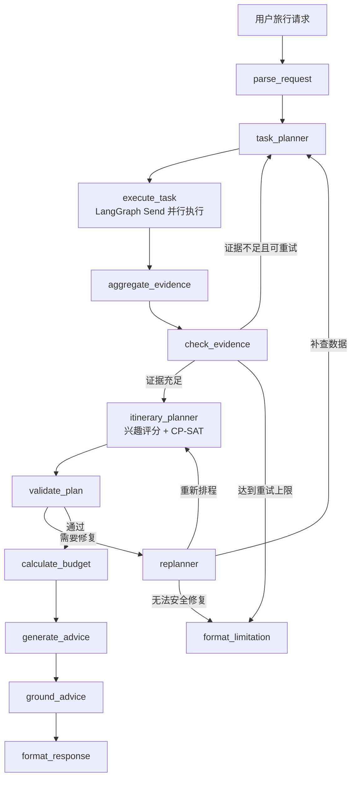

# My Trip Planner

一个基于 **LangGraph、真实工具取证和 OR-Tools 约束求解** 的旅行规划项目。

这个项目的目标不是让大语言模型直接生成一篇旅行文案，而是把旅行规划拆成一条可检查的数据流：先理解请求并收集外部证据，再用确定性算法排程，最后通过独立 Validator 检查硬约束。无法取得足够证据时，系统应明确返回限制，而不是用模型猜测景点、路线或价格。

> 当前定位：这是一个正在持续升级的学习与求职项目。核心规划链路已经可运行，但目的地解析、地理范围校验和部分现实约束仍在建设中。请先阅读[已知限制](#已知限制)，不要把当前结果直接用于真实预订或重要出行决策。

## 项目亮点

- 使用 LangGraph 管理有状态、可循环的旅行规划工作流。
- Task Planner 生成结构化工具任务，Executor 只执行白名单工具。
- 默认通过高德 REST API 获取 POI、天气和路线数据；可选启用高德 MCP。
- 使用 OR-Tools CP-SAT 处理开放时段、活动冲突、景点间交通、用餐时间、必去和禁止条件。
- Validator 独立检查求解结果，不直接相信规划器的输出。
- Price MCP 负责检索价格来源；未知价格保持 `unknown`，不会用 `0` 元代替。
- LLM 只参与兴趣语义评分和建议表达，不决定坐标、开放时间、路线和价格事实。
- 异步任务会记录真实 LangGraph 节点进度，前端不再使用定时器伪造进度。
- 请求、最终计划和编辑修订保存在 SQLite，结果页可以通过 `plan_id` 再次访问。
- 编辑计划时会创建新修订并重新运行工具、求解器和 Validator，而不是只修改浏览器中的 JSON。

## 系统架构



### 双层规划

第一层是任务规划：决定还需要查询什么数据，例如候选景点、天气、酒店、景点间路线和价格。

第二层是行程规划：从已经取得的结构化证据中选择景点，并生成满足时间约束的每日时间轴。

### LLM 与确定性代码的边界

| 模块 | 当前职责 |
| --- | --- |
| LLM | 根据偏好对候选 POI 进行语义评分；在白名单事实范围内组织旅行建议 |
| Task Planner | 使用确定性规则生成白名单工具任务 |
| Executor | 调用高德和价格 MCP，不生成查询文案冒充结果 |
| CP-SAT | 选择景点、安排时间、处理开放窗口、冲突和景点间交通 |
| Validator | 再次检查硬约束和证据完整性 |
| Grounder | 拒绝缺少引用或凭空增加数字的建议 |

因此，当前项目更准确的描述是：**基于 LangGraph 的工具增强约束规划工作流**。它具有 Agent 的状态、工具和反馈循环，但 Task Planner 与 Replanner 仍以规则驱动为主。

## 当前数据流

1. 前端提交 `TripRequest`，后端创建异步 job。
2. `parse_request` 校验日期、旅行天数、每日时间和显式冲突。
3. `task_planner` 生成 POI、天气、酒店等查询任务。
4. LangGraph 使用 `Send` 并行执行工具任务。
5. `aggregate_evidence` 将工具结果标准化为 POI、路线、天气和价格证据。
6. `check_evidence` 过滤开放时间未知、节假日状态不明和命中禁止条件的 POI。
7. 证据不足时回到 Task Planner；证据充足时进入求解器。
8. LLM 或启发式评分器计算兴趣分，CP-SAT 生成行程草稿。
9. Validator 检查时间冲突、开放时间、用餐预留、景点间交通和禁止条件。
10. 校验通过后计算部分预算，并生成带事实引用的建议。
11. 最终计划保存到 SQLite，前端使用 `plan_id` 加载结果。

## 已实现的约束

当前求解器和 Validator 已处理：

- 景点活动必须位于已解析的每周开放时间窗口内。
- 同一天的活动、交通和固定用餐时间不能冲突。
- 每天至少安排一个候选景点，并限制不同节奏下的每日景点上限。
- 必去景点必须被安排一次。
- 显式禁止的地点和类别不能进入行程。
- 同一天相邻景点之间必须存在路线耗时证据。
- 未核实价格不能作为确定价格展示。
- 预算不足属于软约束，使用已知价格计算超预算惩罚。

目前景点游览时长按节奏使用算法估值：

| 节奏 | 单个景点时长 | 每日景点上限 |
| --- | ---: | ---: |
| `relaxed` | 120 分钟 | 2 |
| `normal` | 90 分钟 | 3 |
| `intensive` | 75 分钟 | 4 |

## 证据和价格状态

项目不会把所有外部数据都当成同等可信。

### 价格状态

- `verified`：白名单来源中的单一明确票价。
- `free`：可信来源明确说明免费。
- `estimated_range`：非白名单来源、多个价格档位或可能随日期变化的价格。
- `unknown`：未找到来源或无法可靠提取金额。

预算只汇总存在证据的项目。未知的门票、住宿、餐饮或交通费用会进入 `unknown_items`，不会偷偷按 0 元计算。

> 注意：当前的价格核验仍不等同于完成真实预订。票种、房型、优惠资格、库存和旅行日期仍需在官方渠道确认。

## 技术栈

### 后端

- Python 3.10+
- FastAPI
- LangGraph
- Google OR-Tools CP-SAT
- Pydantic v2
- 高德 Web 服务 REST API
- FastMCP + Tavily Search/Extract
- SQLite
- HelloAgents LLM 封装

### 前端

- Vue 3
- TypeScript
- Vite
- Ant Design Vue
- 高德地图 JavaScript API
- Axios
- html2canvas + jsPDF

## 项目结构

```text
my-trip-planner/
├── backend/
│   ├── app/
│   │   ├── api/                 # FastAPI 应用和路由
│   │   ├── graph/               # LangGraph State、节点和图构建
│   │   ├── mcp/                 # 价格研究 MCP Server
│   │   ├── models/              # API 与规划领域模型
│   │   ├── planning/            # Planner、Executor、Optimizer、Validator 等
│   │   └── services/            # 高德、LLM、价格和 SQLite 服务
│   ├── data/                    # 本地 SQLite 数据库，Git 已忽略
│   ├── tests/                   # 单元测试和离线工作流测试
│   ├── .env.example
│   └── requirements.txt
├── frontend/
│   ├── src/
│   │   ├── services/            # 后端 API 调用
│   │   ├── types/               # TypeScript 类型
│   │   └── views/               # 首页和结果页
│   ├── .env.example
│   └── package.json
└── README.md
```

## 本地启动

### 1. 启动后端

建议始终从 `backend` 目录启动，否则 `.env` 的加载位置可能不符合预期。

```bash
cd ~/workspace/my-trip-planner/backend

python -m venv .venv
source .venv/bin/activate
python -m pip install --upgrade pip
python -m pip install -r requirements.txt

cp .env.example .env
```

至少配置：

```env
# LLM
LLM_MODEL_ID=your-model-name
LLM_API_KEY=your-api-key
LLM_BASE_URL=https://your-api-base/v1

# 高德 Web 服务 Key，用于后端 POI、天气、地理编码和路线 API
AMAP_API_KEY=your-amap-web-service-key

# 默认关闭高德 MCP，直接使用高德官方 REST
AMAP_MCP_ENABLED=false
AMAP_MAX_QPS=1.0
AMAP_MAX_RETRIES=1

# 价格研究，可选；不配置时价格可能保持 unknown
TAVILY_API_KEY=your-tavily-key
PRICE_TRUSTED_DOMAINS=official-scenic.example.cn
```

启动：

```bash
uvicorn app.api.main:app --reload --host 0.0.0.0 --port 8000
```

常用地址：

- API 文档：`http://localhost:8000/docs`
- 服务健康检查：`http://localhost:8000/health`
- 工作流健康检查：`http://localhost:8000/api/trip/health`

### 2. 启动前端

新开一个终端：

```bash
cd ~/workspace/my-trip-planner/frontend
npm install
cp .env.example .env
```

配置：

```env
VITE_API_BASE_URL=http://localhost:8000
VITE_AMAP_WEB_JS_KEY=your-amap-js-api-key
VITE_AMAP_SECURITY_JS_CODE=your-security-js-code
```

这里需要的是高德 **Web 端 JS API Key** 以及与它配套的 `securityJsCode`，不是后端使用的 Web 服务 Key。

启动：

```bash
npm run dev
```

浏览器访问 `http://localhost:5173`。

## 主要 API

| 方法 | 路径 | 用途 |
| --- | --- | --- |
| `POST` | `/api/trip/jobs` | 创建异步规划任务 |
| `GET` | `/api/trip/jobs/{job_id}` | 查询真实工作流进度 |
| `GET` | `/api/trip/plans/{plan_id}` | 读取已保存计划 |
| `POST` | `/api/trip/plans/{plan_id}/replan` | 基于编辑创建新修订并重算 |
| `POST` | `/api/trip/plan` | 同步兼容接口，等待完整规划结果 |
| `GET` | `/api/map/poi` | 调试用 POI 搜索接口 |
| `GET` | `/api/map/weather` | 调试用天气接口 |
| `POST` | `/api/map/route` | 调试用路线接口 |

前端默认使用异步 job API。同步 `/api/trip/plan` 主要用于兼容和接口调试。

## 编辑与版本

结果页的“调整并重新规划”不会直接修改已保存结果：

- 删除景点会转换成新的 `forbidden_places`。
- 新的调整说明会追加到请求中。
- 后端重新执行取证、求解和校验。
- 成功后创建新的 `plan_id`，并记录 `parent_plan_id` 和 `revision`。

默认数据库位置：

```text
backend/data/trip_planner.db
```

数据库文件包含用户旅行请求，已被 Git 忽略。不要把真实用户数据提交到仓库。

## 测试

后端：

```bash
cd backend
python -m pytest -q
```

前端类型检查和生产构建：

```bash
cd frontend
npm run build
```

如果测试提示缺少 `fastmcp`，说明运行测试的 Python 解释器不是安装 `requirements.txt` 的虚拟环境。请先确认：

```bash
which python
python -m pip show fastmcp
```

当前测试覆盖解析器、高德服务降级、价格状态、预算、优化器、Validator、LangGraph 并发状态隔离、API 和 SQLite 持久化。测试仍缺少镇级目的地错配、进程重启恢复和大规模真实城市评测。

## 已知限制

以下问题是当前升级工作的重点：

1. **缺少目的地标准化和地理围栏。** 镇、街道或同名地点可能无法被高德 `region` 稳定识别；系统尚未验证返回 POI 是否位于目标行政区或允许半径内。
2. **自然语言要求尚未全部结构化。** “无障碍”“海鲜过敏”“下午休息”“少换乘”等文字目前不会自动变成求解器硬约束。
3. **长行程能力受候选上限影响。** 普通请求默认最多保留 8 个候选，9 天以上行程可能无法满足每天至少一个景点。
4. **交通不是完整门到门规划。** 当前主要查询景点之间的路线，尚未纳入酒店到首个景点、最后景点回酒店、车站和机场。
5. **酒店与餐厅没有完整参与优化。** 酒店没有房态验证；餐饮主要是时间预留，没有真实餐厅和饮食禁忌排程。
6. **开放时间不等于官方日期核验。** 当前主要依据高德 business 字段，季节性和临时闭馆仍需官方确认。
7. **价格来源仍需加强实体和日期匹配。** `verified` 不代表已经锁定具体票种、房型和库存。
8. **Replanner 策略较简单。** 当前主要执行补查、排除违规 POI 或停止，还不能自动调整半径、交通方式、住宿和节奏。
9. **异步任务只在当前进程运行。** Uvicorn reload 或服务重启后，运行中的 job 不能自动恢复。
10. **数据库没有保存完整证据账本。** 最终计划已持久化，但原始工具结果、Validator 报告和求解器参数尚未全部保存。
11. **地图路线是景点坐标折线。** 它不是高德真实道路 geometry，不应当作导航路线。
12. **图片服务是非核心可选功能。** Unsplash 凭证失效或接口不可用不会影响规划，但结果页会退回占位图。

小目的地没有足够候选时，正确产品行为应是提示用户选择是否扩大搜索范围，而不是静默推荐其他城市。目前这个交互闭环尚未完成。

## 下一阶段路线

### P0：结果正确性

- 增加 `Destination Resolver`，解析标准地址、行政区、adcode、中心坐标和置信度。
- 使用中心点周边搜索，并将距离或行政区匹配加入硬约束。
- 候选不足时向用户请求是否扩大到上一级行政区。
- 增加 `Constraint Parser`，将自然语言要求转换为结构化约束并让用户确认。
- 修复长行程候选数量策略。

### P1：规划真实性

- 把酒店、车站和机场作为真实起终点加入路线模型。
- 使用景点类型或外部证据估计不同游览时长。
- 增加真实餐厅、饮食禁忌和用餐位置规划。
- 为 Replanner 增加定向补查、调整半径、更换住宿和修改节奏策略。
- 保存完整 Evidence Ledger、Validation Report 和求解器配置。

### P2：工程化和评测

- 引入可恢复的后台任务队列和 LangGraph checkpointer。
- 增加认证、用户数据归属、限流、取消任务和数据清理。
- 建立覆盖大城市、小城镇、同名地点、节假日、低预算和工具故障的评测集。
- 记录地域正确率、硬约束满足率、可行计划率、延迟、工具调用量和预算可信度。
- 拆分前端大组件、按需加载导出依赖并展示真实路线 geometry。

## 面试时如何介绍

可以将项目概括为：

> 我把传统的 LLM 旅行文案生成器重构成了一个 LangGraph 双层规划系统。第一层规划并执行外部数据任务，第二层使用 OR-Tools 在开放时间、冲突、交通、用餐、预算和用户偏好约束下求解行程；Validator 和 Replanner 负责失败反馈。LLM 只处理偏好语义与有证据的建议表达，价格和路线由工具提供，未知信息不会伪装成确定事实。

在项目进一步完成地域校验和评测体系后，应重点展示可量化结果，而不只是展示界面截图。

## 许可证与致谢

项目基于原 HelloAgents 旅行规划示例持续重构，用于学习和作品集展示。

- [HelloAgents](https://github.com/datawhalechina/Hello-Agents)
- [高德开放平台](https://lbs.amap.com/)
- [LangGraph](https://github.com/langchain-ai/langgraph)
- [Google OR-Tools](https://developers.google.com/optimization)
- [FastMCP](https://gofastmcp.com/)

许可证沿用原项目的 CC BY-NC-SA 4.0；使用第三方 API 时还需遵守相应平台条款。
